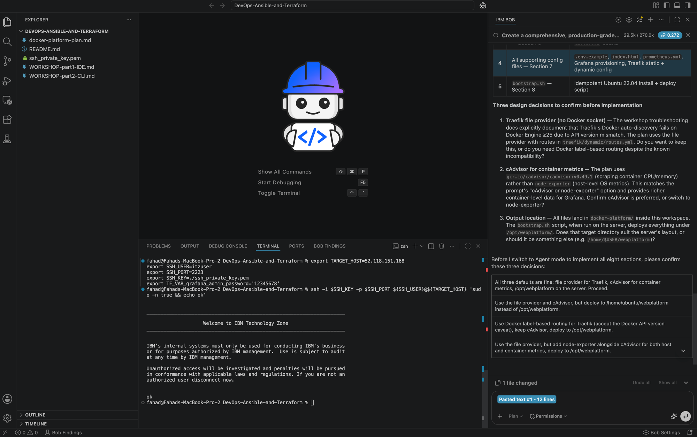

**MODULE 1 | DESIGN**

# **ARCHITECTURE AND PLANNING**

---

## **i. WHAT YOU WILL DESIGN**


!!! quote ""
    Christopher Bienko *(AI Enablement GTM Product Manager)* provides an overview of the *Design - Architecture and Planning* module for the hands-on enablement. **<a href="https://ibm.seismic.com/Link/Content/DCpBCP49fHbTMGqW38cGDfhcfFbd" target="_blank">[2 min]</a>**

!!! note "AI MATURITY CURVE"
    This module is the plan-first delegation discipline of **Module 2 | Delegate**, applied to infrastructure. Bob proposes in Plan mode, you review, and only then does Agent mode write files. Every sub-task carries its own approval gate, and every check Bob runs on its own work needs your consent before it executes. The scope is larger than anything in the previous course; the rhythm is the same one you practiced there.

In this module you hand Bob IDE a one-paragraph requirement and guide it through four steps:

- **Step A**: turn the requirement into an explicit architecture
- **Step B**: generate the Terraform layer (network, containers, volumes)
- **Step C**: generate the Ansible layer (host bootstrap + content)
- **Step D**: audit the result for security and secrets issues

Everything happens in Bob IDE on your laptop; nothing touches the server yet. Deployment is Module 2. Your job at every step is the same: paste the prompt, read what Bob produces, and approve it only when you are satisfied it matches the requirement.

---

### **The requirement**

This single paragraph is the entire specification the platform gets built from:

!!! warning ""
    We have a fresh Ubuntu 22.04 server reachable **only via SSH**. No other inbound ports are open and the cloud security group cannot be changed. We need a production-grade containerized web platform: Traefik as reverse proxy, Apache serving a custom landing page, Prometheus for metrics, and Grafana for dashboards. Every container must bind to 127.0.0.1 (never 0.0.0.0) so access is exclusively through SSH tunnels from the operator's laptop.

---

## **ii. STEP A: UNDERSTAND THE GOAL AND SKETCH THE ARCHITECTURE**

Before writing a single line of code, you need an overarching picture of **what** you are building. That is what this step produces: a component diagram, the request and metrics flows, and the list of variables and secrets.

---

1. **<a href="https://bienko.github.io/bob-devops-iac/setup/#open-the-lab-folder" target="_blank">Open the lab assets folder</a>** within the Bob IDE.

---

2. Copy and paste the following prompt below into Bob's **Agentic Sidebar** chat, then hit ++return++ to execute:

    ```text
    We have a fresh Ubuntu 22.04 server reachable only via SSH at $TARGET_HOST:$SSH_PORT. No other inbound ports are open and the cloud security group cannot be changed. I want a production-grade containerized web platform deployed by code: Traefik 2 as the reverse proxy with access logs, an Apache 2.4 container serving a custom landing page, Prometheus for metrics, Grafana for dashboards (admin password from a variable). Every container must bind to 127.0.0.1 on the host (never 0.0.0.0) so the only way to reach them is through ssh -L tunnels from the operator's laptop. Everything runs on a private Docker network with named volumes and a healthcheck on every container. Describe the target architecture, the request flow from the operator browser through the SSH tunnel into the host loopback into Traefik into Apache, the data flow for metrics, and produce a Mermaid component diagram that explicitly shows the SSH tunnel boundary. Then list the variables, secrets and outputs we will need.

    These decisions are already made. Implement them and do not ask me about them:
    - Host bindings, all on 127.0.0.1: Traefik web entrypoint 80, Traefik dashboard 8080, Grafana 3000, Prometheus 9090. The operator forwards high local ports (8080 to 80, 8081 to 8080); never a local port below 1024, which needs root on the laptop.
    - Traefik routing: one router with rule PathPrefix(`/`) on the web entrypoint, service http://apache_web:80. No Host() rule — the operator arrives through the tunnel as localhost, which no Host rule matches.
    - Images, pinned explicitly, never :latest: traefik:v2.11 (stay on 2.x for the file provider, not Traefik 3), httpd:2.4-alpine (Alpine is required — the self-healing demo needs busybox pidof), prom/prometheus:v2.53.0, grafana/grafana:11.1.0.
    - Prometheus is reachable on 127.0.0.1:9090 for direct PromQL, not internal-only.
    - No Apache metrics. Do not add apache_exporter or Blackbox Exporter. Traefik and Prometheus are the only scrape targets; Apache is measured by Traefik's per-service counters.
    - The Grafana dashboard is a minimal custom JSON written for this stack, never a community dashboard ID.
    ```

---

### **Enhancing the prompt**

3. Click the sparkle icon to enhance the prompt.

    <p align="left">
    
    </p>

---

4. Bob breaks the one-paragraph prompt into a structured spec. The critical constraint is called out on its own, followed by a numbered list of deliverables: the diagram, the request path, the metrics topology, the variables and secrets, the SSH posture, and the limitations.

    <p align="left">
    
    </p>

    Your enhanced prompt should look something like:

    ```text
    Analyze the requirement above and produce a complete platform design for a single-host, multi-container web stack on Ubuntu 22.04 that includes Traefik 2 as an L7 reverse proxy with structured access logs, restart-on-failure policy and file provider configuration, an Apache 2.4 backend serving a Jinja-templated landing page, a Prometheus instance scraping Traefik metrics, a Grafana instance with a pre-provisioned datasource and starter dashboard whose admin password is sourced from a Terraform variable, and a Docker user-defined bridge network isolating all containers with named volumes for Grafana, Prometheus and Traefik certs.

    Critical constraint: every published port MUST bind to the host loopback (ip = "127.0.0.1" in the Docker provider ports block) — nothing on 0.0.0.0. Operator access is exclusively via ssh -L localPort:127.0.0.1:remotePort tunnels from the laptop.

    Produce:
    (1) a Mermaid C4-style component diagram with a clearly labelled SSH-tunnel trust boundary between laptop and host
    (2) the end-to-end request path browser -> ssh tunnel -> host loopback -> Traefik -> Apache
    (3) the metrics scrape topology (all in-host loopback or container-network, never internet)
    (4) a complete table of Terraform variables (target_host, ssh_user, ssh_port, ssh_private_key_path, grafana_admin_password, traefik_local_port, grafana_local_port, prometheus_local_port, traefik_dashboard_local_port)
    (5) Ansible group_vars and required secrets with owner and rotation policy
    (6) the minimum SSH posture on the host (key-only, no password auth)
    (7) the explicit non-goals and known limitations of a single-host, tunnel-only design (no public TLS, single SPOF, operator must be online to demo)
    ```

---

### **Sending the prompt**

5. Switch Bob's mode to **Plan**.

    <p align="left">
    
    </p>

---

6. Hit ++enter++ to instruct Bob to execute the prompt.

---

### **Bob's response**

7. Approve the **create-plan** skill once. This is Bob asking permission to run its planning skill, which writes the design as a plan document you can review, instead of a plain chat reply. Approving it builds nothing yet.

    <p align="left">
    
    </p>

---

8. Bob scans the lab folder, finds only the three workshop files (a clean slate), works out that the entire platform must be designed from scratch, and starts writing the plan.

    <p align="left">
    
    </p>

---

9. Bob writes the platform design document, recording each key design decision with the reason behind it.

    <p align="left">
    
    </p>

---

10. The plan markdown file is now visible in the lab directory.

    <p align="left">
    
    </p>

    !!! warning "YOUR RUN MIGHT NOT MATCH THE SCREENSHOTS WORD-FOR-WORD"
        Bob phrases things differently on each run; what matters is that every item in the checklist below is present.

    ??? info "IF BOB OFFERS TO IMPLEMENT THE WHOLE PLAN"
        After writing the plan, Bob may ask you to pick an option to start implementing everything in one shot. Once the plan is done, click the **stop** button to end the prompt's execution. Implementation starts in Step B.

        <p align="left">
        
        </p>

    ??? info "IF BOB STILL STOPS TO ASK A DESIGN QUESTION"
        The prompt above pins every decision Bob normally asks about, so it should go straight to the plan. If a run asks anyway, the answers are in that list — and the general rule behind them is **use the fewest containers, export only what your two scrape targets actually provide, and pull nothing from an external catalog**.

        Two answers cost the most if given wrong. Never add an Apache exporter: Traefik's per-service counters already measure Apache, and scraping `mod_status` gives Prometheus HTML it cannot parse. And never accept a community Grafana dashboard: they ship in HTTP-API format wrapped in `{"dashboard": {...}}`, which file provisioning rejects with *"Dashboard title cannot be empty"*, leaving you with no dashboards at all.

    Because you are in Plan Mode, Bob responds with a **design document rather than code**. It contains a written architecture description and a Mermaid component diagram. It also lays out the request and metrics flows, along with a table of the variables and secrets the build will need.

---

### **What to check before moving on**

Bob's design should contain all of the following:

- A Mermaid component diagram with the SSH tunnel drawn as an explicit trust boundary
- The request path: browser → `ssh -L` tunnel → host loopback → Traefik → Apache
- A metrics topology that never leaves the host: Prometheus scrapes Traefik over the container network, and **Traefik and Prometheus itself are the only two scrape targets** — no Apache exporter
- A table of variables and secrets: host, user, port, key path, Grafana admin password, local tunnel ports
- Honest limitations: no public TLS, a single host is a single point of failure, and the operator must be online to reach the stack
- The container engine is named as Rancher Desktop, not Docker CE, and the design still uses Docker networks, Docker volumes and the `kreuzwerker/docker` provider

---

## **iii. STEP B: GENERATE THE TERRAFORM LAYER**

This step generates the Terraform half of the platform: **what exists on the server**, the private Rancher network, the four containers, their volumes and port bindings. What runs *inside* all of that (web pages, dashboards, configs) is Ansible's half, generated in Step C.

---

1. Copy and paste the contents of the following code block into the Agentic Sidebar. Since it is long, Bob may show it as a collapsed window — **click** the "copy" icon next to the text block to ensure you've captured the entire statement.

    ```text
    Generate a Terraform layout under infra/terraform/ using the kreuzwerker/docker provider configured against the remote container engine over SSH (ssh://${SSH_USER}@${TARGET_HOST}:${SSH_PORT}, identity file from var.ssh_private_key_path, with ssh_opts -i <key> -o StrictHostKeyChecking=no -o UserKnownHostsFile=/dev/null -o IdentitiesOnly=yes). The engine is headless Rancher Desktop (the rdd daemon), which runs Moby's dockerd underneath and speaks the same Docker API, so this provider needs no Rancher-specific configuration — the Ansible bootstrap role exposes its socket at the standard path for exactly that reason.

    Create modules: network, traefik, web, monitoring. Each module owns its own resources and outputs.

    Critical implementation rules:
    (a) the root versions.tf AND every modules/*/versions.tf must declare kreuzwerker/docker in required_providers - without this, Terraform silently looks for the non-existent hashicorp/docker and init fails
    (b) every container ports block MUST set ip = "127.0.0.1" so nothing is exposed to the public interface
    (c) every container resource must include lifecycle { ignore_changes = [log_opts, user, working_dir, command] } because the Docker daemon's daemon.json log-opts and the image's USER/WORKDIR defaults appear as drift on every plan and trigger needless replacements
    (d) for Traefik specifically, do NOT use the docker provider auto-discovery - modern Docker Engine (25+) requires API >=1.40 but the Traefik docker client library starts at 1.24 and the daemon refuses the handshake. Instead use the file provider (--providers.file.directory=/etc/traefik-dynamic --providers.file.watch=true) with the routing config rendered by Ansible, mounted read-only. Mount it at /etc/traefik-dynamic, not inside /etc/traefik, because a bind mount nested under another mount in the same directory fails unpredictably. This is also better for the security review (no Docker socket exposure)
    (e) for the web module's container, set init = true so Docker injects tini as PID 1 - needed so the self-healing demo in Part 2 actually works (Linux protects PID 1 of a PID namespace from SIGKILL, so without init=true httpd-as-PID-1 cannot be crashed from inside the container)
    (f) every bind-mount source is an absolute path on the remote host, and always a directory, never a single file. The daemon resolves mount sources on the server, so path.module and path.root point at nothing; and Docker creates a missing file source as a directory of that name, which kills the container with "not a directory: Are you trying to mount a directory onto a file"
    (g) every container sets restart = "always", or the self-healing demo in Part 2 has nothing to demonstrate
    (g2) every healthcheck must call a binary that exists in that image. httpd:2.4-alpine ships no wget, curl, nc or busybox, so the usual wget-based test fails forever on a container that is serving correctly and Docker marks it unhealthy. Check what the image contains before writing the test; if it has no HTTP client, use a check that depends only on what is there
    (h) Traefik's entrypoints inside the container are web on :80 and traefik on :8080. Two entrypoints on the same port make Traefik exit at startup with "error opening listener: address already in use". Add --ping=true so its own healthcheck answers
    (i) Traefik access logs must go to stdout: --accesslog=true with no --accesslog.filepath. Promtail tails container stdout, so a filepath sends the access log to a file inside the container where Loki never sees it. Leave the format at its Common Log Format default

    Ansible renders the host files that Terraform mounts, so both layers must name the same paths. Mount these directories, read-only:
    /opt/lab/traefik/dynamic       -> /etc/traefik-dynamic
    /opt/lab/web                   -> /usr/local/apache2/htdocs
    /opt/lab/prometheus            -> /etc/prometheus
    /opt/lab/grafana/provisioning  -> /etc/grafana/provisioning
    /opt/lab/grafana/dashboards    -> /etc/grafana/dashboards

    Name the containers traefik, apache_web, prometheus and grafana, because Part 2 addresses them by name. Publish on the host loopback at Traefik web 127.0.0.1:80, Traefik dashboard 127.0.0.1:8080, Grafana 127.0.0.1:3000, Prometheus 127.0.0.1:9090; those are the ports Part 2 tunnels to, and they are not the same numbers as the laptop-side ports. apache_web publishes nothing and is reached only through Traefik on the private network. Declare grafana_admin_user defaulting to "labadmin" alongside grafana_admin_password.

    Use terraform.tfvars.example for inputs (target_host, ssh_user, ssh_port, ssh_private_key_path, grafana_admin_user, grafana_admin_password, domain) and never hardcode secrets. Generate outputs.tf exposing the localhost URLs operators will hit through the SSH tunnel (e.g. http://localhost:8080 for the app, http://localhost:8081 for the Traefik dashboard, http://localhost:3000 for Grafana, http://localhost:9090 for Prometheus) plus a tunnel_command output that prints the exact one-line ssh -fN -L ... command. The code must pass terraform fmt -check and terraform validate. Include a short README with init/plan/apply commands.
    ```

    <p align="left">
    
    </p>

---

2. Switch Bob's mode to **Agent** so it can write files.

    <p align="left">
    
    </p>

---

3. Hit ++return++ to execute the instructions.

    <p align="left">
    
    </p>

---

### **Infrastructure generation**

4. Bob generates a todo list and asks you to approve it. This is Bob's work plan for the whole step, and it is worth reading item by item because it shows how Bob translated the prompt into work:

    | SUB-TASK | OBJECTIVES |
    |----------|------------|
    | Sub-Task 1 | Generate the Terraform layout under `infra/terraform/` |
    | Sub-Task 2 | Create the root module: `versions.tf`, `variables.tf`, `main.tf`, `outputs.tf`, `terraform.tfvars.example` |
    | Sub-Task 3 | Create the `network` module: the private bridge network `lab_net` that every container joins |
    | Sub-Task 4 | Create the `traefik` module: the reverse proxy container and its certificate volume |
    | Sub-Task 5 | Create the `web` module: the Apache container with `init = true` from rule e |
    | Sub-Task 6 | Create the `monitoring` module: Prometheus and Grafana, each with a data volume |
    | Sub-Task 7 | Validate that every module declares `kreuzwerker/docker` in `required_providers` (rule a) |
    | Sub-Task 8 | Validate that every ports block has `ip = "127.0.0.1"` (rule b) |
    | Sub-Task 9 | Validate that every container has a `lifecycle ignore_changes` block (rule c) |
    | Sub-Task 10 | Run `terraform fmt` and `terraform validate` |

    Note the shape: create first, then validate against the prompt's own rules. Approve the list and Bob works through the items in order, ticking each one off.

    <p align="left">
    
    </p>

---

5. Bob starts with the root module. It asks to create the `infra/terraform/` directory and the root files. These are the provider constraint (`versions.tf`), every input (`variables.tf`), and the wiring that calls the four modules (`main.tf`), together with the outputs and `terraform.tfvars.example`. The approval card shows each file's contents. Skim them, then approve to let Bob write them to the workspace.

    <p align="left">
    
    </p>

---

6. Bob scaffolds the `modules/` directory next, the four folders that will each own one piece of the platform, starting with their `versions.tf` files (rule a from the prompt: the kreuzwerker provider must be declared in every module, or `terraform init` fails in Module 2). Approve to create them.

    <p align="left">
    
    </p>

---

7. Bob writes the network module. It holds a single resource, the private bridge network `lab_net` that every container joins, plus an output the other modules use to attach to it. Approve to create it.

    <p align="left">
    
    </p>

---

8. Bob fills in the three remaining modules (traefik, web, monitoring) and the README. This is the bulk of the code: the container resources with their `127.0.0.1` port bindings, healthchecks, volumes, and lifecycle blocks. Approve to create them.

    <p align="left">
    
    </p>

---

### **Validation checks**

With the files written, Bob verifies its own output. Every check is a shell command, and each command needs your approval before it runs. The exact sequence varies by run; in this run Bob discovers Terraform is not installed locally and falls back to lighter checks.

---

9. The first check is `terraform fmt -recursive -check`, a read-only formatting pass. Because it is a shell command, the IDE asks for an extra approval: check **I understand the risk**, then approve. Every check from here on needs the same confirmation.

    <p align="left">
    
    </p>

---

10. Then the cross-reference checks: three of them run in sequence, each proving one half of the module contract holds.

    - Every `var.` reference inside a module is declared in that module's `variables.tf`.
    - Every `module.X.Y` reference in the root matches an output module X actually declares.
    - Every argument the root passes into a module block is a variable that module accepts.
    - Bob wrote these checks itself. Read the commands before approving — this is Bob defining what "validated" means, then proving it.

    <p align="left">
    
    </p>

---

11. A final listing confirms the layout is complete, Bob closes out its todo list, and the `infra` folder appears in the lab directory: everything you just approved is now on disk.

    <p align="left">
    
    </p>

---

### **Review the generated files**

12. Expand the `infra/terraform/` folder to see everything Bob created.

    <p align="left">
    
    </p>

    !!! quote ""
        **One module per component:**

        ```text hl_lines="2 3 4 5 6 7"
        infra/terraform/
        ├── versions.tf                  <- root provider constraint
        ├── variables.tf                 <- all inputs incl. port vars
        ├── main.tf                      <- provider + 4 module calls
        ├── outputs.tf                   <- ports, URLs, tunnel_command
        ├── terraform.tfvars.example     <- copy to terraform.tfvars, fill in values
        ├── README.md                    <- init/plan/apply commands
        └── modules/
            ├── network/                 <- the private bridge network (lab_net)
            │   └── versions.tf  main.tf  outputs.tf
            ├── traefik/                 <- Traefik container (file provider, no Docker socket)
            │   └── versions.tf  variables.tf  main.tf  outputs.tf
            ├── web/                     <- Apache container (init = true for the self-heal demo)
            │   └── versions.tf  variables.tf  main.tf  outputs.tf
            └── monitoring/              <- Prometheus + Grafana (Loki and Promtail join in Step F)
                └── versions.tf  variables.tf  main.tf  outputs.tf
        ```

---

### **README.md**

Bob also writes a `README.md` inside `infra/terraform/`, documenting the layer end to end:

- **Layout**: the file tree above, with the purpose of each file and module.
- **Quick start**: the exact run order, fill in `terraform.tfvars`, run the Ansible bootstrap first, then `init`, `plan`, `apply`, and open the SSH tunnels.
- **Expected plan**: what the first `terraform plan` should report, so you know a healthy run when you see one.
- **Idempotency**: why a second `plan` must show no changes, and which `lifecycle` block makes that true.
- **Design decisions**: the reasoning behind the file provider, `init = true` on Apache, and the loopback-only port bindings.
- **Tear-down**: how to kill the tunnel and destroy the stack, with a warning that destroying removes the data volumes.

It doubles as a reference when you deploy in Module 2.

---

### **What to check before moving on**

!!! note "WHY THE CONTRACT IS IN THE PROMPT"
    Left to itself, Bob picks reasonable but different names on every run: `web` instead of `apache_web`, `admin` instead of `labadmin`, `traefik_remote_port` instead of `traefik_dashboard_url`. Each one is fine in isolation and each one breaks a command in Module 2 or 3 that was written against the other name. Naming the contract up front is what makes the rest of the lab reproducible.

- Every `ports` block sets `ip = "127.0.0.1"`: this is the lab's entire security model (rule b)
- A `versions.tf` declaring `kreuzwerker/docker` exists in the root **and in every module**, otherwise `terraform init` fails in Module 2 (rule a)
- Every container has `lifecycle { ignore_changes = [log_opts, user, working_dir, command] }`, otherwise every future `terraform plan` shows phantom drift (rule c)
- Traefik uses the **file provider** rather than docker auto-discovery (rule d)
- The web container sets `init = true`; Module 3's self-healing demo is impossible without it (rule e)
- Secrets appear only as variable references (`var.grafana_admin_password`), never literal values, and `terraform.tfvars.example` covers all inputs
- The contract holds: containers are named `traefik`, `apache_web`, `prometheus`, `grafana`; `grafana_admin_user` defaults to `labadmin`; `outputs.tf` declares `app_url`, `traefik_dashboard_url`, `grafana_url`, `prometheus_url`, `grafana_admin_user`, `tunnel_command`. Module 2 calls every one of those by name

---

## **iv. STEP C: GENERATE THE ANSIBLE LAYER**

Now for the other half. Ansible handles everything Terraform does not: preparing the host itself (installing headless Rancher Desktop) and generating the content the containers serve. That content comprises the landing page, the Traefik routes, the Prometheus scrape config, and the Grafana dashboard.

---

1. Copy and paste the contents of the following code block into the Agentic Sidebar, then hit ++return++ to eexecute. Since it is long, Bob may show it as a collapsed window — **click** the "copy" icon next to the text block to ensure you've captured the entire statement. Bob stays in **Agent** mode from Step B.

    ```text
    Generate an Ansible layout under infra/ansible/ with an inventory file inventory.ini (using ansible_port, ansible_user and ansible_ssh_private_key_file so any non-default SSH port is supported), a top-level site.yml and roles:

    In inventory.ini, write ansible_ssh_private_key_file as an absolute path and wrap the value in double quotes. INI inventory splits host lines on whitespace, so an unquoted path containing a space (a lab folder named "IBM BOB DEV OPS") fails to parse; Ansible then falls back to implicit localhost and silently runs every task against the operator's laptop instead of the server. A relative path breaks the same way whenever a command runs from a directory other than infra/ansible. Also set private_key_file in ansible.cfg as a fallback.

    - common (kernel sysctls, journald limits - leave ufw alone, no public ports are used)
    - docker (install headless Rancher Desktop if not present — the standalone rdd daemon binary from the rancher-desktop-2 GitHub releases, pinned to an exact release tag (v2.0.0-alpha.1 at time of writing) and never "latest": rdd is alpha and has no upgrade path between versions, so an unpinned install breaks this lab the day the next alpha ships. NOT the Rancher Desktop GUI app and NOT the rancher/rancher server image, neither of which runs on a headless SSH-only host. Run it as a systemd service so the engine survives reboots and SSH disconnects, and expose its Docker-compatible socket at the standard /var/run/docker.sock path so the Terraform provider and every docker command in this lab work unchanged — rdd's socket path is not documented, so discover it at runtime and then symlink it to /var/run/docker.sock rather than hardcoding a guess. rdd runs the Moby engine inside a Lima VM, so the host filesystem is NOT the daemon's filesystem: add /opt/lab to rdd's VM mount list as a writable mount before any container starts, and verify from inside Rancher Desktop that a file Ansible rendered on the host is actually readable there. Do not assume the bind mount resolved. Add the SSH user to the docker group only if the socket turns out to need it, set log driver = json-file with rotation, and configure a daily prune timer, noting in the README if rdd's engine does not support either)
    - web_content (render the Apache vhost and landing page from Jinja templates into a host bind-mount)
    - monitoring_content (Prometheus scrape config, Grafana datasource provisioning and a starter dashboard JSON)

    Every task must be idempotent and tagged. Use an ansible-vault-friendly variable layout with group_vars/all/vars.yml and group_vars/all/vault.yml. Provide an ansible-lint-clean output and a one-liner to run the full playbook.

    Terraform mounts these exact host directories, so create them and render into them with no extra nesting:
    - /opt/lab/traefik/dynamic/routes.yml   one router matching PathPrefix(`/`) on the web entrypoint, service http://apache_web:80. No Host() rule: the operator arrives through a tunnel as localhost, which no Host rule matches.
    - /opt/lab/web/index.html               the landing page. Its text must contain the word "Welcome", which Part 2 greps for.
    - /opt/lab/prometheus/prometheus.yml    the scrape config
    - /opt/lab/grafana/provisioning/        datasource and dashboard-provider files
    - /opt/lab/grafana/dashboards/          the dashboard JSON

    Every task that renders a file must be preceded by a task that creates its parent directory with state: directory. This applies to system paths too, not just /opt/lab: /etc/systemd/journald.conf.d does not exist on a fresh Ubuntu 22.04, so templating into it fails the play outright. Create system directories as standalone file tasks, not by adding them to the /opt/lab loop, so the bootstrap and content tag split stays clean.

    Create every one of those directories mode 0755 and every rendered file mode 0644. The containers run as non-root (Prometheus as nobody, uid 65534), so a directory created 0750 root:root cannot be traversed by the process that has to read the file inside it, and Prometheus crash-loops with "open /etc/prometheus/prometheus.yml: permission denied" while the file itself looks perfectly readable.

    Prefix every variable a role defines with that role's name — everything in defaults/, everything in vars/, and every register: (monitoring_content_result, not result; web_content_lab_root, not lab_root). ansible-lint's var-naming[no-role-prefix] applies to all three locations, not just register, and every unprefixed one is a separate failure that stops the Part 2 pre-flight before it deploys anything.

    Start every task and handler name with a capital letter, or ansible-lint fails name[casing] once per task. If you prefix names with the role, capitalise the prefix too (Docker | Install prerequisites, not docker | Install prerequisites).

    Tag every task in common and docker with `bootstrap` and every task in web_content and monitoring_content with `content`, because Part 2 invokes the playbook by those two tag names and nothing else. If the engine's socket does require group membership, put a meta: reset_connection immediately after the task that adds the SSH user to that group, or the rest of the run keeps the old membership and every docker call fails on the socket. Prove the bootstrap actually worked by running a plain `docker ps` over SSH at the end of the role, not by trusting that the playbook exited zero.

    Write the dashboard JSON in Grafana's file-provisioning format: title, uid and schemaVersion at the top level, every panel with gridPos, every target with refId. Do not wrap it in a {"dashboard": {...}} envelope, which is the HTTP API format and makes Grafana reject the file with "Dashboard title cannot be empty" and show no dashboards at all. Only query metrics that a scrape target in prometheus.yml actually exports; Traefik and Prometheus itself are the only exporters here, so container and host metrics do not exist and any panel using them renders "No data".

    Prometheus and Grafana read their config only at startup, and Terraform may have created them before these files existed, so give each a handler that restarts the container when its config changes and that does nothing when the container is not there yet.

    Leave vault.yml unencrypted and gitignored, and do not set vault_password_file in ansible.cfg. Document the ansible-vault encrypt command in the README as the production step instead. Part 2 runs the playbook non-interactively, so a configured vault password file that does not exist fails every play before it starts.

    Three details in the observability config that are wrong by default and silently break every dashboard built on them:

    1. In the Prometheus scrape config, do not attach a static `service` label to any job whose target exports its own `service` label. Prometheus renames the exporter's label to `exported_service` and keeps the static one, so every query filtering on `service` matches nothing while the data sits under a different name. Set `honor_labels: true` on the Traefik job.
    2. In the Traefik static config, the `metrics.prometheus` block must set `addRoutersLabels: true`, `addEntryPointsLabels: true` and `addServicesLabels: true`. Router-level metrics are off by default, so `traefik_router_*` does not exist unless you ask for it.
    3. Any log scraper must label every stream with `container_name`, so a panel or pipeline stage can select one container. A single shared `job` label makes every container indistinguishable downstream.
    ```

    <p align="left">
    
    </p>

---

### **Bob's plan**

2. Before writing anything, Bob works out where the two layers meet: the host paths that Terraform's containers mount and that Ansible must therefore populate.

    | Host path | What Ansible renders into it |
    |---|---|
    | `/opt/lab/traefik/dynamic/` | Traefik's file-provider routes |
    | `/opt/lab/web/` | the Apache document root |
    | `/opt/lab/prometheus/prometheus.yml` | the scrape config |
    | `/opt/lab/grafana/provisioning/` | the Grafana datasource and dashboards |

---

3. Bob then proposes a todo list and asks you to approve it. It covers the layout, the config files, the four roles, and two self-checks. Read the list first. It is Bob's plan for the whole step, and every item on it is explained further down, at the point where Bob runs it.

    <p align="left">
    
    </p>

    Your list may include an extra item that Bob added on its own. In this run, Bob re-read the Step B files, found a bug in how a Terraform flag was written, and added the fix to the list. Bob always explains why it added something. Read that explanation, because work you did not ask for is the work most worth checking.

---

### **Ansible generation**

4. Bob announces it will write the entire Ansible layout in parallel batches. Approve the todo update.

    <p align="left">
    
    </p>

---

5. Approve again as Bob writes the files. It writes the config first (`ansible.cfg`, `inventory.ini`, `group_vars`, `site.yml`), then all four roles simultaneously, then the Jinja templates. It finishes with the Grafana dashboard JSON, the most complex artifact. This one approval covers eight of the todo items:

    <p align="left">
    
    </p>

    | SUB-TASK | OBJECTIVES |
    |----------|------------|
    | Sub-Task 1 | Write `ansible.cfg`: which inventory to use and how to SSH to the host |
    | Sub-Task 2 | Write `inventory.ini` with `ansible_port`, `ansible_user`, and the key file, so the non-standard SSH port works |
    | Sub-Task 3 | Split `group_vars/all/vars.yml` from `vault.yml` so secrets can be encrypted later on their own |
    | Sub-Task 4 | Write `site.yml`, tagged so Module 2 can run bootstrap and content rendering separately |
    | Sub-Task 5 | Build the `common` role: kernel parameters and journal log limits |
    | Sub-Task 6 | Build the `docker` role: install Rancher Desktop headless under systemd, expose its socket at `/var/run/docker.sock`, mount `/opt/lab` into the Rancher Desktop VM, log rotation, and a daily prune timer |
    | Sub-Task 7 | Build the `web_content` role: Traefik's file-provider routes and the Apache landing page |
    | Sub-Task 8 | Build the `monitoring_content` role: the Prometheus scrape config and the Grafana provisioning chain |

    Bob works outward from the smallest dependency. Sub-tasks 1 to 4 come first because everything else refers to them, since a role cannot resolve a variable `group_vars` has not declared. The four roles do not depend on each other, so Bob writes them in one parallel batch. The Grafana dashboard JSON comes last, being the largest and most error-prone file.

---

### **Validation and fixes**

With 23 files written, Bob checks its own work. This run turns into a real bug hunt, and it is worth following closely, because it shows what Bob does when a check fails.

---

6. Bob writes a Python script with five static checks. Every YAML file must parse, and every task must carry `tags`. Every template variable must match a declared `vars.yml` key, every Jinja template must render, and the dashboard JSON must be valid once the Jinja markers are stripped. This is the todo's two verification items being executed. Approve it.

    <p align="left">
    
    </p>

    !!! info "VERIFY IDEMPOTENCY PATTERNS ON EVERY TASK"
        Bob's self-check for the prompt's "every task must be idempotent" rule: `creates:` and `stat` guards that make a task a no-op when the work is already done.

    !!! info "VERIFY ALL TASKS ARE TAGGED"
        Self-check for the other prompt rule, so any slice of the playbook can be run on its own.

    ??? warning "IF THE SCRIPT FAILS ON A MISSING PARSER"
        The script needs PyYAML. If it is not on your machine, Bob installs it, confirms the install, and retries on its own. Approve those commands and the run continues.

---

7. The suite runs against every generated file.

    - If a check fails, Bob patches the file and runs the suite again. Sometimes it finds the fault was in its own test rather than in the file.
    - Approve each round. What matters is where it ends. Every file should pass, and if Bob dismisses a failure it should be able to say why.

    <p align="left">
    
    </p>

---

8. The todo list closes out with every item done, and a final listing confirms the finished tree.

---

### **Review the generated files**

9. Bob summarises what it generated. The `infra` folder now sits in the explorer.

    <p align="left">
    
    </p>

---

10. Expand `infra/ansible` to see the full layout.

    <p align="left">
    
    </p>

    Where Terraform (Step B) answered "what exists on the server," this layer answers "how it is prepared and what content it serves":

    !!! warning ""
        The exact file names Bob generates may vary from run to run.

    ```text hl_lines="4 5 23 29 38 39 40 41 42"
    infra/ansible/
    ├── group_vars/
    │   └── all/
    │       ├── vars.yml                       <- shared variables
    │       └── vault.yml                      <- secrets, to be encrypted with ansible-vault
    ├── roles/
    │   ├── common/                            <- kernel sysctls, journald limits
    │   │   ├── handlers/
    │   │   │   └── main.yml
    │   │   ├── meta/
    │   │   │   └── main.yml
    │   │   ├── tasks/
    │   │   │   └── main.yml
    │   │   └── templates/
    │   ├── docker/                            <- Rancher Desktop install, socket, /opt/lab VM mount, prune timer
    │   │   ├── handlers/
    │   │   │   └── main.yml
    │   │   ├── meta/
    │   │   │   └── main.yml
    │   │   ├── tasks/
    │   │   │   └── main.yml
    │   │   └── templates/
    │   │       └── daemon.json.j2             <- engine daemon config: log rotation (may be absent, Rancher Desktop does not always read it)
    │   ├── monitoring_content/
    │   │   ├── meta/
    │   │   │   └── main.yml
    │   │   ├── tasks/
    │   │   │   └── main.yml
    │   │   └── templates/                     <- prometheus.yml.j2 + the Grafana
    │   │                                         provisioning chain: datasource,
    │   │                                         dashboard provider, dashboard JSON
    │   └── web_content/
    │       ├── meta/
    │       │   └── main.yml
    │       ├── tasks/
    │       │   └── main.yml
    │       └── templates/
    │           ├── index.html.j2              <- the landing page Apache serves
    │           └── routes.yml.j2              <- the Traefik file-provider routes
    ├── ansible.cfg                            <- Ansible behavior: inventory path, SSH settings
    ├── inventory.ini                          <- the target server: host, port, user, key
    └── site.yml                               <- single entrypoint, applies all roles in order
    ```

---

### **What to check before moving on**

- `inventory.ini` sets `ansible_port`, `ansible_user`, and `ansible_ssh_private_key_file`. These tell Ansible how to SSH into the server; without them it assumes port 22 and fails to connect at all on a non-default port like TechZone's
- All four roles are present: `common`, `docker`, `web_content`, `monitoring_content`
- Every task is tagged and idempotent; Module 2 runs this playbook more than once, so a second run must change nothing
- The two tags Module 2 uses actually exist: `ansible-playbook site.yml --list-tasks --tags bootstrap` and `--tags content` each list tasks rather than nothing
- If the role adds the SSH user to a group for socket access, a `meta: reset_connection` follows immediately after it
- `/opt/lab` is mounted into the Rancher Desktop VM and the role proves it: a file Ansible rendered on the host must be readable from inside Rancher Desktop. Without this every bind mount silently resolves to an empty directory, and the whole stack comes up "healthy" while serving nothing.
- Secrets live in `group_vars/all/vault.yml` and that file is gitignored. It stays unencrypted for the lab, so Module 2 can run the playbook without a vault prompt
- The `docker` role installs Rancher Desktop only if missing, pinned to an exact release tag, runs it as a systemd service, and ends by proving the engine works with a plain `docker ps` over SSH

---

## **v. STEP D: SECURITY & SECRETS REVIEW**

In Steps B and C, Bob wrote a lot of code quickly, and you are about to run it against a real server. Before that happens, this step turns Bob into its own reviewer: it re-reads everything it just generated, checking for the kinds of mistakes that can hurt in production. For example:

- A password sitting in a file
- A port accidentally open to the whole internet instead of loopback
- A container running with more privileges than it needs

---

1. Paste the prompt below into Bob's chat and send it. Bob stays in **Agent** mode.

    ```text
    Audit the generated Terraform and Ansible for: secrets in code or state, any port bound to 0.0.0.0 instead of 127.0.0.1, weak Grafana defaults, container privilege escalation, exposed Docker socket without read-only mode, missing resource limits and missing log drivers. For each finding give severity (low/med/high), exploit scenario in one line and the minimal fix as a unified diff. Then propose a remote-state backend (S3+DynamoDB or equivalent) with state encryption and locking, and an ansible-vault strategy for the Grafana admin password.

    Four things are already decided. List them as accepted risks with the reason and leave the code alone:
    - The Traefik dashboard and API stay unauthenticated. Only the operator's own SSH tunnel reaches them, and a generated BasicAuth hash is a password nobody can type.
    - There is no TLS. SSH is the encryption layer and every operator URL is plain http on localhost.
    - State stays local. Write the backend as a proposal; do not add a backend block, because terraform init would then try to resolve it and Part 2 has no cloud credentials.
    - vault.yml stays unencrypted and gitignored, because Part 2 runs the playbook non-interactively.

    Do not rename anything Part 2 depends on: the container names, grafana_admin_user, the bootstrap and content tags, or the /opt/lab paths. If a fix genuinely needs one of those changed, raise it as a finding and stop rather than applying it. If you harden SSH host key checking, use StrictHostKeyChecking=accept-new and never yes, because Part 2 runs unattended and yes turns a first connection into a prompt nobody answers.
    ```

    <p align="left">
    
    </p>

---

### **The audit**

2. Bob re-reads everything it wrote in Steps B and C, then turns the audit into a todo list of findings ranked by severity. Approve it, then read the findings before you approve any fix. This table is the security lesson of the module:

    <p align="left">
    
    </p>

    | FINDING | SEVERITY | THE FIX |
    |---------|----------|---------|
    | F-01 `grafana_admin_password` written to `terraform.tfstate` in plaintext | HIGH | Mark the output `sensitive = true`; the real cure is the encrypted remote backend in F-04 |
    | F-02 `vault.yml` holds the secret unencrypted, so any `git add -A` commits it | HIGH | A gitignore entry, plus the documented `ansible-vault encrypt` command for production |
    | F-04 No remote state backend, so state is unencrypted, unlocked, and unshared | HIGH | The S3 + DynamoDB design, written up as documentation rather than applied |
    | F-05 `StrictHostKeyChecking=no` lets an impostor server intercept the SSH connection | MED | `accept-new`, which pins the key on first use and still never prompts |
    | F-06 Grafana's `GF_SECURITY_*` settings left at defaults | MED | Set the hardening environment variables explicitly |
    | F-07 No resource limits, so one runaway container can starve the host | MED | Memory and CPU limits on every container |
    | F-08 No `log_driver` block, so containers log without bounds if `daemon.json` is wrong | MED | Declare the log driver per container |
    | F-09 No `no_log`, so sensitive tasks print the password into playbook output | MED | `no_log: true` on the tasks handling `grafana_admin_password` |
    | F-10 No `.gitignore` for `terraform.tfvars` and `*.pem` | LOW | Ignore the real variable values and the SSH private key |
    | F-11 Promtail mounts `docker.sock` to discover containers | LOW | Mount it read-only and narrow the bind to what Promtail actually reads |

    Bob ranks by severity rather than by file, so the list doubles as a priority order.

    !!! note "THE THREE HIGHS ARE A SINGLE PROBLEM"
        F-01, F-02 and F-09 are all the same Grafana password, leaking through three different channels:

        | Finding | Where it leaks |
        |---|---|
        | F-01 | Terraform state |
        | F-02 | git history |
        | F-09 | playbook output |

        F-04 is what would contain the first of them in production, and it is the one finding you deliberately do not apply here.

    Now notice what is **missing** from the table: the Traefik dashboard.

    Left unconstrained, Bob rates `api.insecure=true` a HIGH and puts a BasicAuth middleware in front of it, generating the password hash itself. The dashboard then answers 401 for the rest of the lab, and nobody knows the credentials.

    The accepted-risks block in your prompt is what keeps it out of the findings. Bob still records its reasoning in the report either way.

---

3. Approve the todo list. Bob applies the fixes file by file, then writes the remote state backend and the ansible-vault strategy doc the prompt asked for. Approve the todo updates as it goes.

    <p align="left">
    
    </p>

---

4. Afterwards, Bob produces a **Security Audit** report. Each finding comes with its severity, a one-line exploit scenario, and the exact diff applied, followed by the accepted risks it left alone. Click **Open** on the report card and read it end to end.

    <p align="left">
    
    </p>

    In this run Bob applied every fix itself, so your job shifts from applying to verifying:

    1. **Read each finding in the report** and decide whether you agree it was a real problem and that the fix is right.
    2. **Spot-check the diffs** in the changed files, the same way you reviewed Steps B and C.
    3. **Ask Bob to revert** anything you disagree with, and re-run the audit prompt if you want a clean pass to confirm.

    The result of this step is what you deploy in Module 2: code that has already survived a security review before it ever touched the server.

---

### **What to check before moving on**

- Every finding has all three parts: severity, exploit scenario, and a concrete diff; a finding without a fix is not actionable
- Every **high-severity** finding is applied.
- The re-run of the audit prompt comes back clean (or only with findings you have consciously accepted)
- The accepted risks survived the audit untouched: no BasicAuth middleware appeared in front of the Traefik dashboard, no TLS was added, no `backend` block was written, and `vault.yml` is still readable
- Nothing from the platform contract was renamed. Run the contract check in [Review & Approval](#vi-review-approval) below before you move on
- Bob wrote the two extras as documentation only: the remote state backend with encryption and locking, and the ansible-vault strategy for the Grafana admin password

---

## **vi. REVIEW & APPROVAL**

Bob has now generated everything Module 2 will deploy. Before you approve it, verify the properties that matter. Each check below is a command you paste into the Bob IDE terminal, and each catches a specific mistake.

---

**1. Every published port binds to loopback**

Every line this prints must say `127.0.0.1`. A single `0.0.0.0` means a service is exposed to the internet and the security model is broken.

```bash
grep -rn 'ip *=' infra/terraform --include='*.tf'
```

---

**2. Five `versions.tf` files exist — the root plus one per module**

A missing one means `terraform init` fails in Module 2, because Terraform looks for the non-existent `hashicorp/docker` provider instead of `kreuzwerker/docker`.

```bash
ls infra/terraform/versions.tf infra/terraform/modules/*/versions.tf
```

---

**3. The Apache container sets `init = true`**

Module 3's self-healing demo is impossible without it: httpd running as PID 1 cannot be killed from inside the container.

```bash
grep -n 'init' infra/terraform/modules/web/main.tf
```

---

**4. No literal passwords in the code**

Every line this prints must be a variable reference or declaration (`var.grafana_admin_password`), never an actual password value.

```bash
grep -rni 'password' infra/terraform --include='*.tf'
```

---

**5. The container names Modules 2 and 3 hardcode**

All four must print. A rename here breaks the self-healing demo, which addresses containers by name.

```bash
grep -rn 'name *= *"' infra/terraform/modules --include='*.tf' \
  | grep -E 'traefik|apache_web|prometheus|grafana'
```

---

**6. The output names Module 2 reads back after apply**

All six must print.

```bash
grep -n '^output' infra/terraform/outputs.tf
```

---

**7. The two Ansible tags Module 2 invokes**

Both must list tasks. A tag that matches nothing makes Module 2 skip that half of the deployment silently.

```bash
cd infra/ansible
ansible-playbook site.yml --list-tasks --tags bootstrap | tail -5
ansible-playbook site.yml --list-tasks --tags content | tail -5
cd ../..
```

---

**8. The accepted risks are still accepted**

The Traefik dashboard carries no BasicAuth, TLS is absent, no remote backend block exists, and `vault.yml` remains readable. The last command must *not* print `$ANSIBLE_VAULT;1.1` — an encrypted vault file makes Module 2's non-interactive run fail before it starts.

```bash
grep -rn 'basicauth\|users *=\|tls\|acme' infra/terraform --include='*.tf'
grep -rn 'backend "' infra/terraform --include='*.tf'
head -1 infra/ansible/group_vars/all/vault.yml
```

---

**9. The linters actually pass**

Module 2's pre-flight runs both of these and stops the deployment if either fails, without fixing anything. Prove it here instead.

```bash
terraform fmt -check -recursive infra/terraform
cd infra/ansible && ansible-lint; cd ../..
```

Both must print nothing and exit 0. Run them yourself even if Bob's Step E report says the code is clean.

??? warning "TROUBLESHOOTING: `terraform fmt -check` PRINTS A FILENAME"
    **Cause** — that file's `=` signs are misaligned. Nothing else.

    **Fix** — reformat in place:

    ```bash
    terraform fmt -recursive infra/terraform
    ```

    This is whitespace only and cannot change what your infrastructure does.

    Always use `-recursive`. Plain `terraform fmt -check` looks at the current directory only and never descends into `modules/`, so it can pass while a module is still unformatted.

??? warning "TROUBLESHOOTING: `ansible-lint` REPORTS DOZENS OF FAILURES"
    **Cause** — two rules account for almost all of them:

    - `var-naming[no-role-prefix]` — a variable in `defaults/`, `vars/` or `register:` without its role-name prefix
    - `name[casing]` — a task name not starting with a capital letter

    Both are cosmetic, but each occurrence counts as its own failure, so a handful of naming choices becomes 60+ findings.

    **Fix** — paste the output back to Bob and have it correct the names before you approve the step.

??? warning "TROUBLESHOOTING: BOB'S STEP E REPORT SAYS CLEAN BUT THE LINTERS DISAGREE"
    **Cause** — Step E can be answered from Bob's model of what the linters would say rather than by running them. The report then reads clean while the real tools fail.

    **Fix** — trust the commands above rather than the report. Show Bob the real output and have it fix what the tools actually found.

Then two things to read rather than grep:

- **The architecture document from Step A** — does it still match what Steps B and C actually generated?
- **The audit findings from Step D** — is every high-severity finding either fixed or something you consciously decided to accept?

If a check fails, tell Bob what you found and have it fix the code, then re-run the check.

---

## **vii. KEY TAKEAWAYS**

- A one-paragraph requirement, enhanced into a structured spec and answered in Plan mode, produces a reviewable design document before any code exists.
- The prompts pin every decision Bob would otherwise ask about, and they name the contract (container names, outputs, tags, paths) that Modules 2 and 3 depend upon.
- Terraform owns what exists on the server; Ansible owns how the host is prepared and what content the containers serve, and both layers must name the same paths.
- Bob validates its own output with checks it wrote itself; read those commands before approving them, and run the linters yourself regardless.
- The security audit is constrained by an accepted-risks block, which is what keeps the tunnel-only Traefik dashboard out of the findings.
- Whatever passes the review checks here is exactly what Module 2 deploys.

</br>
Continue to [Validation & Enhancement](1-2.md){:target="_blank"}, where the same plan-review loop adds four more steps. An idempotency, lint, and drift audit comes first, followed by the observability stack (Loki + Promtail). A disaster-recovery runbook and a CI/CD pipeline complete the module.

---