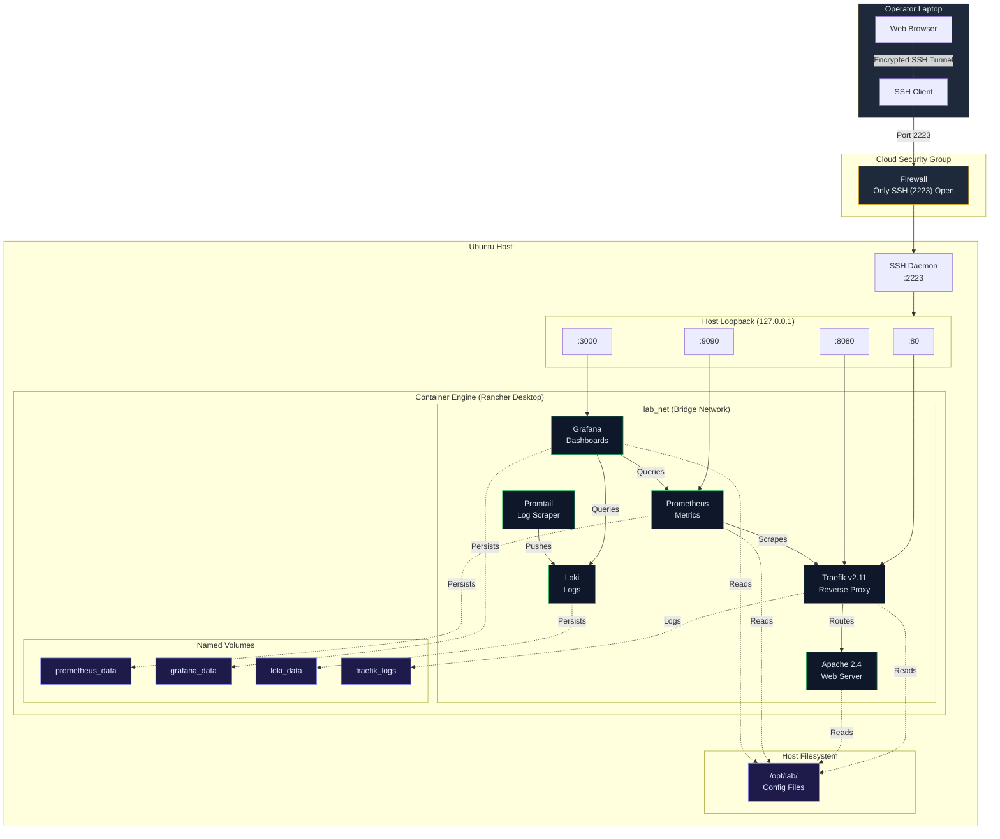

**REFERENCE**
# **PLATFORM ARCHITECTURE**

---

## **i. PURPOSE OF THIS REFERENCE**

!!! note ""
    This reference describes the platform *as designed*. Bob generates the code fresh on every run, so where this document and your repository differ — image versions, volume names, retention windows — the code in your repository is authoritative.

This document describes the architecture of the containerized web platform deployed in this lab. The platform demonstrates production-grade infrastructure-as-code practices with a focus on security, observability, and operational excellence.

---

## **ii. HIGH-LEVEL ARCHITECTURE**



---


## **iii. DESIGN PRINCIPLES**

---

### **1. Zero-trust networking**

**Principle:** No services are exposed to the public internet.

**Implementation:**

- All containers bind to `127.0.0.1` (localhost only)
- No ports bound to `0.0.0.0` (all interfaces)
- Access exclusively via encrypted SSH tunnels
- Firewall only allows SSH inbound

**Benefits:**

- Eliminates attack surface
- No need for TLS certificates
- Simplified security posture
- Compliance-friendly

---

### **2. Infrastructure as code**

**Principle:** All infrastructure is defined in version-controlled code.

**Implementation:**

- Terraform manages Docker resources via the kreuzwerker/docker provider
- Ansible manages host configuration
- Git tracks all changes
- CI/CD validates before deployment

**Benefits:**

- Reproducible deployments
- Auditable changes
- Disaster recovery ready
- Environment parity

---

### **3. Observability first**

**Principle:** Comprehensive monitoring and logging from the first deployment onward.

**Implementation:**

- Prometheus for metrics collection
- Grafana for visualization
- Loki for log aggregation
- Pre-configured dashboards

**Benefits:**

- Proactive issue detection
- Root cause analysis
- Performance optimization
- SLA compliance

---

### **4. Self-healing**

**Principle:** Automatic recovery from failures.

**Implementation:**

- Docker restart policies (`always`)
- Health checks on all containers
- Init system (tini) for proper signal handling
- Automated monitoring and alerting

**Benefits:**

- Reduced downtime
- Lower operational burden
- Improved reliability
- Faster recovery

---

## **iv. COMPONENT DETAILS**

---

### **Traefik (reverse proxy)**

**Purpose:** L7 reverse proxy and load balancer

**Key Features:**

- Dynamic routing configuration
- Metrics endpoint for Prometheus
- Access logging to volume
- Health checks

**Configuration:**

- Static config: Command-line flags
- Dynamic config: File provider (`/opt/lab/traefik/dynamic/routes.yml`)
- Metrics: Exposed on `:8080/metrics`

**Port Bindings:**

- `127.0.0.1:80` → HTTP traffic
- `127.0.0.1:8080` → Dashboard and metrics

**Volumes:**

- `traefik_logs` → `/var/log/traefik` (access logs)
- `/opt/lab/traefik/dynamic` → `/etc/traefik/dynamic` (routes)

---

### **Apache (web server)**

**Purpose:** Serve static web content

**Key Features:**

- Custom landing page
- Init system (tini) for proper PID 1
- Health check endpoint
- Read-only content mount

**Configuration:**

- Content: `/opt/lab/web/index.html`
- Document root: `/usr/local/apache2/htdocs`

**Port Bindings:**

- Internal only (accessed via Traefik)

**Volumes:**

- `/opt/lab/web` → `/usr/local/apache2/htdocs` (read-only)

---

### **Prometheus (metrics)**

**Purpose:** Time-series metrics collection and storage

**Key Features:**

- Scrapes Traefik metrics
- Self-scraping for meta-monitoring
- 15-day retention (configurable)
- Persistent storage

**Configuration:**

- Scrape config: `/opt/lab/prometheus/prometheus.yml`
- Targets: Traefik, Prometheus itself

**Port Bindings:**

- `127.0.0.1:9090` → Web UI and API

**Volumes:**

- `prometheus_data` → `/prometheus` (TSDB)
- `/opt/lab/prometheus` → `/etc/prometheus` (config)

---

### **Grafana (visualization)**

**Purpose:** Metrics and logs visualization

**Key Features:**

- Pre-provisioned Prometheus datasource
- Pre-configured dashboards
- Persistent database
- Admin password from Terraform variable

**Configuration:**

- Datasources: `/opt/lab/grafana/provisioning/datasources/`
- Dashboards: `/opt/lab/grafana/provisioning/dashboards/`

**Port Bindings:**

- `127.0.0.1:3000` → Web UI

**Volumes:**

- `grafana_data` → `/var/lib/grafana` (SQLite DB)
- `/opt/lab/grafana/provisioning` → `/etc/grafana/provisioning` (config)

---

### **Loki (log aggregation)**

**Purpose:** Centralized log storage and querying

**Key Features:**

- Receives logs from Promtail
- Compressed storage
- LogQL query language
- Persistent chunks

**Configuration:**

- Config: `/opt/lab/loki/loki-config.yml`

**Port Bindings:**

- `127.0.0.1:3100` → HTTP API

**Volumes:**

- `loki_data` → `/loki` (chunks and index)
- `/opt/lab/loki` → `/etc/loki` (config)

---

### **Promtail (log scraper)**

**Purpose:** Collect container logs and push to Loki

**Key Features:**

- Scrapes container logs via the Docker socket
- Labels logs by container
- Pushes to Loki
- No persistent storage needed

**Configuration:**

- Config: `/opt/lab/promtail/promtail-config.yml`

**Port Bindings:**

- None (internal only)

**Volumes:**

- `/var/run/docker.sock` → `/var/run/docker.sock` (read-only)
- `/var/lib/docker/containers` → `/var/lib/docker/containers` (read-only)
- `/opt/lab/promtail` → `/etc/promtail` (config)

**Note (Rancher Desktop):** these two host paths are the *VM's* paths, not the Ubuntu host's. Promtail runs as a container inside the same VM as Docker, so the mounts still resolve — but do not expect `/var/lib/docker/containers` to exist on the Ubuntu host itself.

---

## **v. NETWORK ARCHITECTURE**

---

### **Docker bridge network**

**Name:** `lab_net`

**Type:** Bridge (user-defined)

**Purpose:** Isolate containers from host network and other Docker networks

**Connected Containers:**

- traefik
- apache_web
- prometheus
- grafana
- loki
- promtail

**DNS:** Automatic container name resolution

---

### **SSH tunnel architecture**

```
┌─────────────────────────────────────────────────────────────┐
│ Operator Laptop                                             │
│                                                             │
│  Browser :8080 ──┐                                         │
│  Browser :8081 ──┤                                         │
│  Browser :3000 ──┼─→ SSH Client (ssh -L)                  │
│  Browser :9090 ──┘                                         │
│                                                             │
└────────────────────────┬────────────────────────────────────┘
                         │
                         │ Encrypted SSH Connection
                         │ Port 2223
                         │
┌────────────────────────▼────────────────────────────────────┐
│ Remote Host                                                 │
│                                                             │
│  SSH Daemon :2223 ──→ Forwards to 127.0.0.1                │
│                                                             │
│  127.0.0.1:80   ──→ Traefik                                │
│  127.0.0.1:8080 ──→ Traefik Dashboard                      │
│  127.0.0.1:3000 ──→ Grafana                                │
│  127.0.0.1:9090 ──→ Prometheus                             │
│                                                             │
└─────────────────────────────────────────────────────────────┘
```

**Tunnel Mappings:**

| Local Port | Remote Service | Purpose |
|------------|----------------|---------|
| 8080 | 127.0.0.1:80 | Application (via Traefik) |
| 8081 | 127.0.0.1:8080 | Traefik dashboard |
| 3000 | 127.0.0.1:3000 | Grafana |
| 9090 | 127.0.0.1:9090 | Prometheus |

---

## **vi. DATA FLOW**

---

### **HTTP request flow**

```
1. Browser (localhost:8080)
   ↓
2. SSH Tunnel (encrypted)
   ↓
3. Remote Host (127.0.0.1:80)
   ↓
4. Traefik (routing logic)
   ↓
5. Apache (via the private Docker network)
   ↓
6. Response (reverse path)
```

---

### **Metrics flow**

```
1. Traefik exposes /metrics endpoint
   ↓
2. Prometheus scrapes every 15s
   ↓
3. Prometheus stores in TSDB
   ↓
4. Grafana queries Prometheus
   ↓
5. Dashboard displays metrics
```

---

### **Logs flow**

```
1. Containers write to stdout/stderr
   ↓
2. Docker captures logs
   ↓
3. Promtail reads from the Docker socket
   ↓
4. Promtail pushes to Loki
   ↓
5. Loki stores compressed chunks
   ↓
6. Grafana queries Loki (LogQL)
   ↓
7. Dashboard displays logs
```

---


## **vii. STORAGE ARCHITECTURE**

---

### **Named volumes**

**Purpose:** Persistent data that survives container restarts

| Volume | Size | Retention | Backup Priority |
|--------|------|-----------|-----------------|
| `prometheus_data` | ~1GB/week | 15 days | Medium |
| `grafana_data` | ~100MB | Indefinite | High |
| `loki_data` | ~500MB/week | 7 days | Low |
| `traefik_logs` | ~50MB/day | 7 days | Low |

---

### **Bind mounts**

**Purpose:** Configuration files managed by Ansible

| Host Path | Container | Purpose |
|-----------|-----------|---------|
| `/opt/lab/traefik/dynamic/` | traefik | Routing rules |
| `/opt/lab/web/` | apache_web | Static content |
| `/opt/lab/prometheus/` | prometheus | Scrape config |
| `/opt/lab/grafana/provisioning/` | grafana | Datasources, dashboards |
| `/opt/lab/loki/` | loki | Loki config |
| `/opt/lab/promtail/` | promtail | Promtail config |

---

## **viii. SECURITY ARCHITECTURE**

---

### **Defense in depth**

**Layer 1: Network Isolation**

- No public ports exposed
- All services on 127.0.0.1
- SSH-only access

**Layer 2: Container Isolation**

- User-defined bridge network
- No privileged containers
- Read-only mounts where possible

**Layer 3: Access Control**

- SSH key-based authentication
- No password authentication
- Grafana admin password from variable

**Layer 4: Secrets Management**

- Terraform variables for secrets
- Ansible Vault for sensitive data
- No secrets in code or state

**Layer 5: Monitoring**

- All access logged
- Metrics collected
- Anomaly detection ready

---

### **Threat model**

| Threat | Mitigation | Residual Risk |
|--------|------------|---------------|
| **Unauthorized access** | SSH keys only, no public ports | Low |
| **Container escape** | Non-privileged containers, read-only mounts | Low |
| **Data exfiltration** | No outbound restrictions (accept risk) | Medium |
| **DDoS** | No public exposure | None |
| **Insider threat** | Audit logs, least privilege | Medium |

---

## **ix. SCALABILITY CONSIDERATIONS**

---

### **Current limitations**

**Single Host:**

- No horizontal scaling
- Single point of failure
- Limited by host resources

**No Load Balancing:**

- Single Traefik instance
- No failover

**Local Storage:**

- Volumes tied to host
- No distributed storage

---

### **Scaling path**

**Phase 1: Vertical Scaling**

- Increase host resources (CPU, RAM)
- Add resource limits to containers
- Optimize Prometheus retention

**Phase 2: Multi-Container**

- Multiple Apache instances
- Traefik load balancing
- Prometheus federation

**Phase 3: Multi-Host**

- Migrate to Kubernetes
- Distributed storage (Ceph, GlusterFS)
- Multi-region deployment

---

## **x. DISASTER RECOVERY**

---

### **RTO/RPO targets**

| Scenario | RTO | RPO | Strategy |
|----------|-----|-----|----------|
| Container crash | 30 sec | 0 | Auto-restart |
| Bad deployment | 5 min | 0 | Rollback |
| Host failure | 30 min | 15 min | Rebuild + restore |
| Data corruption | 1 hour | 1 hour | Restore from backup |

---

### **Backup strategy**

**What to back up:**

- Grafana data volume (SQLite DB)
- Prometheus data volume (TSDB)
- Loki data volume (log chunks)

**What to leave out:**

- Container images — pulled again from the registry
- Traefik logs — ephemeral

**Backup Frequency:**

- Grafana: Daily
- Prometheus: Weekly
- Loki: Weekly

**Backup Location:**

- Local: `/var/backups/lab/`
- Remote: S3 bucket (optional)

---

## **xi. OPERATIONAL PROCEDURES**

---

### **Deployment**

1. Bootstrap host (Ansible)
2. Provision infrastructure (Terraform)
3. Configure services (Ansible)
4. Open SSH tunnels
5. Validate endpoints

---

### **Monitoring**

1. Check Grafana dashboards
2. Review Prometheus targets
3. Query Loki logs
4. Verify container health

---

### **Maintenance**

1. Update container images
2. Apply Terraform changes
3. Re-run Ansible playbooks
4. Verify idempotency

---

### **Troubleshooting**

1. Check container logs
2. Verify port bindings
3. Test SSH tunnels
4. Review metrics and logs

---

## **xii. TECHNOLOGY STACK**

| Layer | Technology | Version | Purpose |
|-------|------------|---------|---------|
| **OS** | Ubuntu | 22.04 LTS | Host operating system |
| **Container Runtime** | Rancher Desktop (headless) | 2.0.0-alpha.1 (pin it) | Container runtime |
| **IaC - Provisioning** | Terraform | 1.6+ | Infrastructure provisioning |
| **IaC - Configuration** | Ansible | 2.15+ | Host and service configuration |
| **Reverse Proxy** | Traefik | 2.11 | L7 routing and load balancing |
| **Web Server** | Apache httpd | 2.4 | Static content serving |
| **Metrics** | Prometheus | 2.53.0 | Time-series metrics |
| **Visualization** | Grafana | 11.1.0 | Dashboards and alerting |
| **Logs** | Loki | 3.0+ | Log aggregation |
| **Log Scraper** | Promtail | 3.0+ | Container log collection |

---

## **xiii. GLOSSARY**

- **Bridge Network:** Docker network type that creates a private network on the host
- **Health Check:** Automated test to verify container is functioning correctly
- **Init System:** Process manager (tini) that runs as PID 1 in containers
- **Named Volume:** Docker-managed persistent storage
- **Restart Policy:** Docker configuration for automatic container restart
- **SSH Tunnel:** Encrypted connection forwarding local ports to remote services
- **Zero-Trust:** Security model assuming no implicit trust
- **RDD:** Rancher Desktop Daemon, the core background service that manages the Rancher Desktop 2.0 virtual machine, container engine, and Kubernetes cluster

---