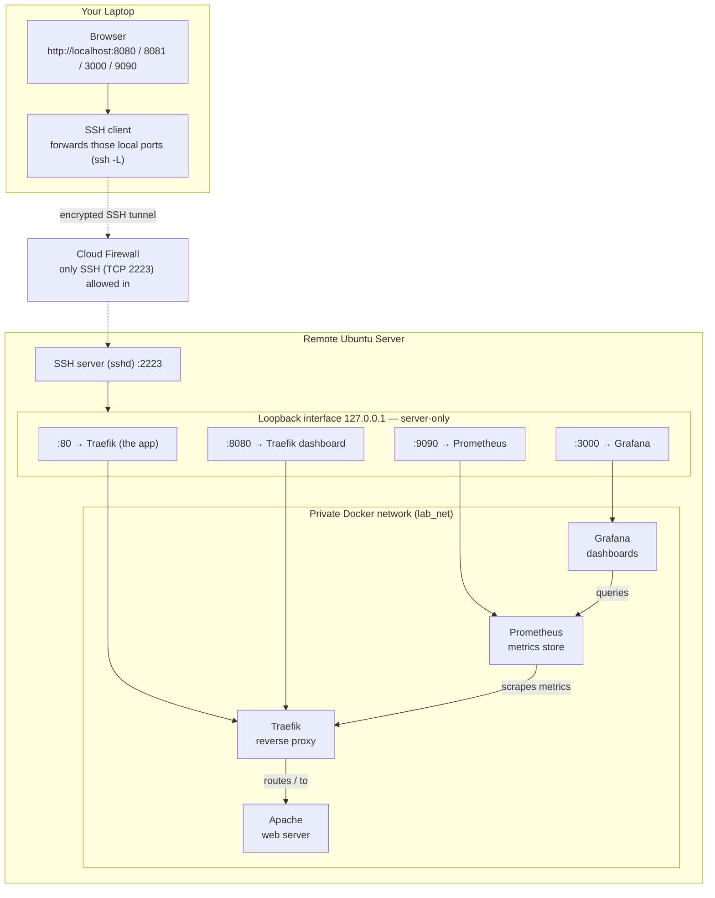

# **DevOps Infrastructure as Code with IBM Bob**

---

## **i. "Infrastructure as code" paradigm for modern platforms**

!!! quote ""
    Christopher Bienko *(AI Enablement GTM Product Manager)* introduces the *DevOps Infrastructure as Code with IBM Bob* curriculum for hands-on enablement. **<a href="https://ibm.seismic.com/Link/Content/DCc2VpP4VhJHVGMQ4D8d7Fp7cDCB" target="_blank">[4 min]</a>**

Most production platforms today are built and operated through automation. Instead of configuring servers by hand, teams describe the desired state of their infrastructure in code and let tools make reality match that description. This practice is known as Infrastructure as Code (IaC).

Two of the most widely used tools are Terraform, which provisions infrastructure, and Ansible, which configures it. This lab uses both, together with Rancher Desktop, which provides the container engine.

!!! info "RANCHER vs. DOCKER — WHY THE MIXED NAMING CONVENTIONS?"
    You install **one** piece of software on the server: **Rancher Desktop**, running *headless* (no graphical interface, because the server has no desktop). It ships a daemon binary called **`rdd`**, which is what the Ansible role installs and what systemd runs.

    Rancher Desktop provides a **Docker-compatible container engine**. That is why, throughout this lab, you still type `docker ps`, Terraform still uses the `kreuzwerker/docker` provider, and the socket is still `/var/run/docker.sock`. **"Docker" here names the interface, not a second product.** Nothing in this lab installs Docker Desktop or Docker CE.

    So when you read these pages:

    | When you see | It means |
    |---|---|
    | **Rancher Desktop** | the software installed on the server — installing it, its systemd service, its VM, its version |
    | **`rdd`** | the literal daemon binary and systemd unit name, nothing more |
    | **Docker** | the interface Rancher Desktop exposes — the `docker` command, Docker networks and volumes, restart policies, `/var/run/docker.sock`, the `kreuzwerker/docker` provider |

    If a sentence is about *what is installed*, it says Rancher Desktop. If it is about *what you type or what the code declares*, it says Docker. There is no third thing.

Even with mature tooling, building a platform still involves real challenges:

- Designing an architecture that is secure by default
- Keeping code modular, idempotent, and reviewable
- Handling secrets without leaking them into code or state
- Reasoning about drift, blast radius, and rollback
- Producing runbooks and documentation that stay current

It is precisely these challenges that IBM Bob was designed to address.

This lab is designed for DevOps engineers, platform engineers, SRE teams, and cloud architects. Anyone comfortable with a terminal can follow along, however.

---

## **ii. What is IBM Bob?**

**IBM Bob is an AI-powered software engineering partner that supports the entire development lifecycle.** Where a traditional code-completion tool is anchored to the moment of writing code, Bob is designed to support the lifecycle around it. Bob helps teams:

- Design architectures from requirements
- Generate infrastructure and application code
- Review its own work for security issues
- Deploy and validate systems
- Produce diagrams, runbooks, and CI/CD wiring
- Troubleshoot and operate what it built

!!! warning "RECOMMENDED PREREQUISITE: *CLIMBING THE AI MATURITY CURVE WITH IBM BOB LEVEL 3*"
    This course is best taken after the <a href="https://ibm.github.io/bob-l3/" target="_blank">**Climbing the AI Maturity Curve with IBM Bob**</a> Level 3 curriculum. It assumes those concepts are familiar ground: the Agentic Sidebar and its modes, the plan-first delegation discipline, and the review-before-trust habit that carried through every stage of that course. The material ahead builds directly upon that foundation.

Bob operates directly within the development environment, so you keep complete visibility into every stage of the process.

Throughout this hands-on lab, you give Bob a one-paragraph requirement and end with a working web platform running on a remote Ubuntu server. Bob designs the architecture and writes the Terraform and Ansible. It then reviews that code, deploys it, and proves that it works. Your job is to steer it with prompts and to judge the results.

---

## **iii. Environment: the web platform**

The platform you build in this hands-on lab is four containers on a private Rancher Desktop network, provisioned by Terraform and configured by Ansible.

| Component | Responsibility |
|-----------|----------------|
| **Traefik v2.11** | Reverse proxy. The single entry point that receives every incoming request and routes it to the right backend service. It also publishes metrics about the traffic it handles. [Docs](https://doc.traefik.io/traefik/){:target="_blank"} |
| **Apache 2.4** | The application. The classic open-source web server, here serving a landing page behind Traefik. [Docs](https://httpd.apache.org/docs/2.4/){:target="_blank"} |
| **Prometheus** | Metrics store. A time-series database that collects metrics by scraping HTTP endpoints. Here it scrapes Traefik, so you can see request rates and response codes over time. [Docs](https://prometheus.io/docs/introduction/overview/){:target="_blank"} |
| **Grafana** | Dashboards. Turns metrics into charts. It arrives pre-provisioned with Prometheus as a datasource and a ready-made dashboard for the stack. [Docs](https://grafana.com/docs/){:target="_blank"} |

This is the standard production pattern. A proxy sits in front and the application behind it. Metrics are collected from the traffic, and dashboards are layered on top.

The defining constraint: **nothing is publicly exposed**. Every container binds to `127.0.0.1` on the remote host. The cloud security group allows only SSH inbound. You reach the services from your laptop through SSH tunnels (`ssh -L`), and secrets live in Ansible Vault rather than in code or Terraform state.

Best practices built into the code, each verified during the lab:

- Idempotent Ansible playbooks. Running them a second time changes nothing, which you confirm with `make idempotency`
- Modular Terraform (network, traefik, web, monitoring), so each piece can be changed independently
- A health check and restart policy on every container. In Module 3 you kill a container and watch Rancher's restart policy bring it back
- Full rebuild from code alone. No configuration lives outside the repository

---

## **iv. Architecture**

The lab uses two machines: **your laptop** and **one remote Ubuntu server**. Everything runs on the server, inside four containers. Your laptop only sends commands and displays the dashboards.

Note, however, that the server has no web ports open. Its firewall blocks every incoming connection except SSH on port 2223. To reach the dashboards, you run an SSH command that forwards a few local ports (like `localhost:8080`) to the server, so the web pages travel inside the SSH connection instead of over the open internet. The diagram below shows that path.

!!! note "FOLLOW ONE REQUEST"
    You open `http://localhost:8080` in your browser. The SSH client picks the request up and carries it, encrypted, through the tunnel to the server. There it hands the request to `127.0.0.1:80`, where Traefik is listening. Traefik routes it to the Apache container, and the page comes back the same way. To your browser it all looks local. The only thing that ever crossed the internet was SSH traffic.

!!! info "HOW TO READ THE DIAGRAM"
    There are three parts, read from top of the diagram to the bottom:

    1. **"Your Laptop" (left box)**: where you sit. You browse to normal-looking addresses like `http://localhost:8080`. Those pages are *not* served by your laptop: an SSH command you'll run during the lab forwards those ports over to the server behind the scenes.

    2. **"Cloud Firewall" (middle)**: the server's only door. It lets SSH in (port 2223) and blocks everything else, so none of the web services are directly reachable from the internet.

    3. **"Remote Ubuntu Server" (right box)**: where everything actually runs. It has two layers:
        - The **`127.0.0.1` row** lists the ports the containers are published on. `127.0.0.1` means "this machine only": those ports answer the server itself (and your SSH tunnel, which arrives *as* the server), but never the outside world.
        - The **private Rancher network** at the bottom holds the four containers. The arrows show who talks to whom: Traefik passes web requests to Apache, Prometheus pulls metrics from Traefik, and Grafana reads its charts from Prometheus.

---

## **v. The lab journey**

| Module | Focus | What You'll Learn |
|--------|-------|-------------------|
| **1. Design** | Create the infrastructure code with **Bob IDE** | Design production-grade infrastructure from a one paragraph brief, generate modular Terraform and Ansible, run security and compliance reviews, add the observability stack, and build runbooks and CI pipelines |
| **2. Deploy** | Ship it with **Bob Shell** | Execute a single-prompt deployment: bootstrap the host, provision with Terraform, configure with Ansible, open SSH tunnels, and validate every endpoint |
| **3. Operate** | Run it | Navigate Grafana dashboards, query Prometheus, demonstrate self-healing by crashing a container, and practice disaster recovery |

---

## **vi. What you will build**

!!! note "**A WORD ON WORKING WITH GENERATIVE AI**"

    IBM Bob is powered by generative AI and LLMs, and a defining trait of these systems is that they are *non-deterministic* — unlike the *deterministic* tools most developers are accustomed to. In practice, that means the same prompt can produce different code from one run to the next. This is both a strength and a quirk of the technology, and it is something to work *with* rather than against.

    **Precision is what tips the odds in your favor.** The more clearly you describe what you want, the more closely Bob's output will mirror your intent; conversely, the smallest change in wording can meaningfully change the generated code. Throughout this lab, your results may differ from the solutions shown — and that is expected, not a defect. Whenever an output diverges, you have three good options: refine the prompt and try again, edit the generated code by hand, or simply proceed if the variation still compiles and runs. Human review remains essential at every step, and never more so than while you are still learning the tool.

    **You always stay in control.** Bob proposes the architecture, generates the code, and runs the deployment. At every step, however, **you** review and approve what it produced before anything touches the server. This is the same discipline you practiced throughout the *AI Maturity Curve* course.

The lab repository begins with little more than a README file and the two workshop walkthroughs. Everything else is written by Bob during the lab, then reviewed and approved by you.

**The code (Module 1).** Using Bob IDE, you will build:

- An architecture document with a diagram
- Modular Terraform: network, traefik, web, and monitoring modules
- Ansible roles that install the container engine and render every service config
- Secrets encrypted with Ansible Vault
- A security and compliance review of the generated code
- Log aggregation with Loki and Promtail added to the monitoring stack
- A disaster recovery runbook
- A GitHub Actions pipeline, plus a Makefile that runs the same checks locally

**The platform (Module 2).** Using Bob Shell, you deploy that code to the remote server. Bob bootstraps the host with Rancher Desktop and creates the network and containers with Terraform. It then renders the configs with Ansible, opens the SSH tunnels, and validates every endpoint. The result is the four-container stack from section iii, live and reachable from your browser.

**The proof (Module 3).** You then operate what you built. You read the Grafana dashboards and query Prometheus. You kill a container and watch it self-heal, and you run a recovery drill from the runbook Bob wrote.

---

## **vii. Next steps**

Proceed to the [Setup](setup.md){:target="_blank"} page to prepare your environment, then continue to [Module 1 - Design](1-1.md){:target="_blank"} to start building with Bob.

---